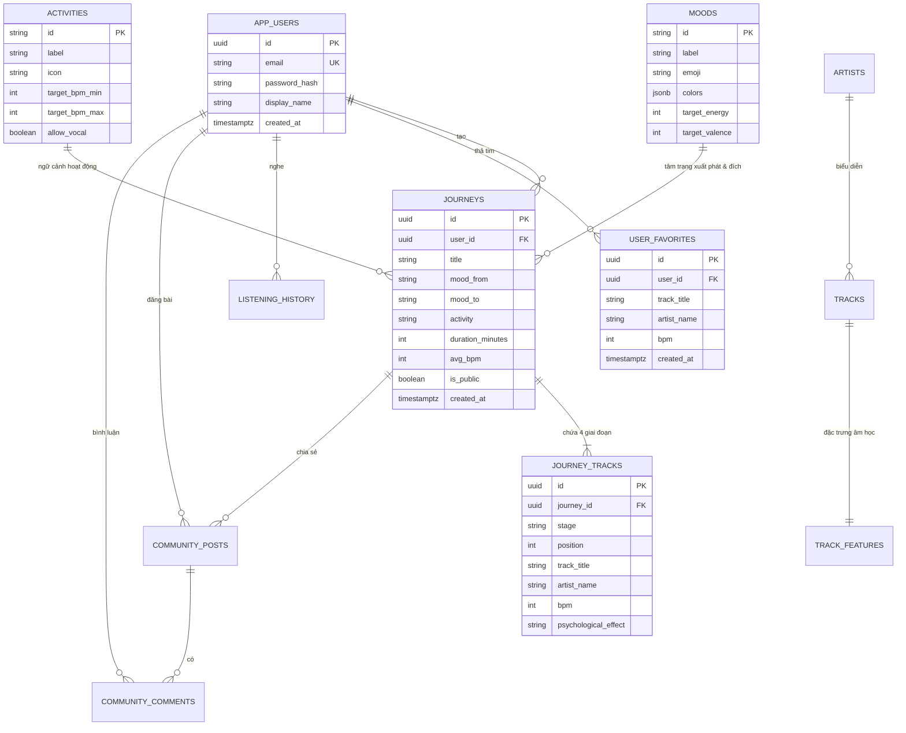

# 📐 TÀI LIỆU ĐẶC TẢ CƠ SỞ DỮ LIỆU – MOODFLOW
> **Hệ quản trị CSDL:** PostgreSQL (Supabase Cloud)  
> **Cơ chế định danh người dùng:** `public.app_users` (Bcrypt Password Hashing + JWT Token)  
> **Phiên bản đặc tả:** 2.0 (Cập nhật chuẩn hóa 8 Tâm trạng, 4 Hoạt động, Hành trình 4 giai đoạn, Music DNA & Cộng đồng)

---

## 🗺️ 1. SƠ ĐỒ THỰC THỂ QUAN HỆ (ERD - ENTITY RELATIONSHIP DIAGRAM)

---

## 📋 2. CHI TIẾT CÁC BẢNG DỮ LIỆU (TABLE SPECIFICATIONS)

### 2.1. Bảng `app_users` (Người dùng & Xác thực độc lập)
*Lưu trữ tài khoản người dùng đăng ký qua máy chủ Backend (mã hóa mật khẩu bằng Bcrypt 10 rounds, không phụ thuộc vào Email Rate Limit).*

| Tên cột | Kiểu dữ liệu | Ràng buộc | Mô tả |
| :--- | :--- | :--- | :--- |
| `id` | `UUID` | `PRIMARY KEY`, Default: `gen_random_uuid()` | Khóa chính định danh người dùng |
| `email` | `VARCHAR(255)` | `UNIQUE`, `NOT NULL` | Địa chỉ email đăng nhập (chuẩn hóa chữ thường) |
| `password_hash` | `TEXT` | `NOT NULL` | Mật khẩu đã băm một chiều an toàn bằng Bcrypt |
| `display_name` | `VARCHAR(100)` | `NOT NULL`, Default: `'Người nghe'` | Tên hiển thị của người dùng trên giao diện |
| `role` | `VARCHAR(20)` | `NOT NULL`, Default: `'user'`, Check: `'user', 'admin'` | Phân quyền tài khoản: `'user'` (Người nghe thông thường) hoặc `'admin'` (Quản trị viên hệ thống) |
| `created_at` | `TIMESTAMPTZ` | Default: `now()` | Thời điểm tạo tài khoản |
| `updated_at` | `TIMESTAMPTZ` | Default: `now()` | Thời điểm cập nhật gần nhất |

---

### 2.2. Bảng `moods` (Danh mục 8 Tâm trạng chuẩn)
*Là nguồn dữ liệu gốc (Single Source of Truth) phục vụ Flow Engine và AI Assistant.*

| Tên cột | Kiểu dữ liệu | Ràng buộc | Mô tả |
| :--- | :--- | :--- | :--- |
| `id` | `VARCHAR(50)` | `PRIMARY KEY` | Mã định danh mood (ví dụ: `deep_focus`, `calm_unwind`) |
| `label` | `VARCHAR(100)` | `NOT NULL` | Tên tiếng Việt (ví dụ: *Tập trung sâu*, *Bùng nổ năng lượng*) |
| `emoji` | `VARCHAR(10)` | `NOT NULL` | Biểu tượng cảm xúc (ví dụ: `🧠`, `😌`, `🔥`, `💔`) |
| `colors` | `JSONB` | `NOT NULL` | Mảng mã màu gradient (ví dụ: `["#0F172A", "#22D3EE"]`) |
| `tagline` | `TEXT` | | Câu dẫn truyền cảm xúc của mood |
| `target_energy` | `INT` | Check: `0..100` | Mức năng lượng tâm lý học (Russells Circumplex Model) |
| `target_valence` | `INT` | Check: `0..100` | Mức độ tích cực cảm xúc |
| `display_order` | `INT` | Default: `1` | Thứ tự sắp xếp hiển thị trên giao diện |

---

### 2.3. Bảng `activities` (Danh mục 4 Hoạt động & Giới hạn BPM)
*Định nghĩa tiêu chuẩn y khoa âm nhạc cho từng bối cảnh làm việc, thiền, thể thao hoặc giấc ngủ.*

| Tên cột | Kiểu dữ liệu | Ràng buộc | Mô tả |
| :--- | :--- | :--- | :--- |
| `id` | `VARCHAR(50)` | `PRIMARY KEY` | Mã hoạt động (`deep_work`, `meditation`, `workout`, `sleep`) |
| `label` | `VARCHAR(100)` | `NOT NULL` | Tên hoạt động (*Làm việc sâu*, *Thiền định*, *Tập luyện*, *Giấc ngủ*) |
| `icon` | `VARCHAR(50)` | `NOT NULL` | Icon đại diện (`laptop`, `flower`, `activity`, `moon`) |
| `target_bpm_min` | `INT` | `NOT NULL` | Nhịp tim tối thiểu mục tiêu (BPM) |
| `target_bpm_max` | `INT` | `NOT NULL` | Nhịp tim tối đa mục tiêu (BPM) |
| `allow_vocal` | `BOOLEAN` | `NOT NULL` | Cho phép nhạc có lời (`TRUE`) hay chỉ nhạc không lời (`FALSE`) |
| `display_order` | `INT` | Default: `1` | Thứ tự hiển thị |

---

### 2.4. Bảng `journeys` (Hành trình âm nhạc đã tạo & đã lưu)
*Lưu trữ hành trình tổng quan, liên kết với tài khoản người dùng để phục vụ cá nhân hóa và chia sẻ.*

| Tên cột | Kiểu dữ liệu | Ràng buộc | Mô tả |
| :--- | :--- | :--- | :--- |
| `id` | `UUID` | `PRIMARY KEY`, Default: `gen_random_uuid()` | Khóa chính của hành trình |
| `user_id` | `UUID` | `REFERENCES app_users(id)` | ID người dùng tạo ra hành trình này |
| `title` | `TEXT` | `NOT NULL` | Tiêu đề hành trình (VD: `🧠 Tập trung sâu ➔ 😌 Thư giãn & Bình yên`) |
| `mood_from` | `VARCHAR(50)` | `NOT NULL` | Tâm trạng xuất phát |
| `mood_to` | `VARCHAR(50)` | `NOT NULL` | Tâm trạng mục tiêu hướng đến |
| `activity` | `VARCHAR(50)` | `NOT NULL` | Ngữ cảnh hoạt động |
| `duration_minutes` | `INT` | Default: `30` | Tổng thời lượng trị liệu (15, 30, 45, 60 phút) |
| `avg_bpm` | `INT` | Default: `75` | Nhịp BPM trung bình của toàn bộ hành trình |
| `is_public` | `BOOLEAN` | Default: `FALSE` | Trạng thái công khai trên Bảng tin Cộng đồng |
| `created_at` | `TIMESTAMPTZ` | Default: `now()` | Thời điểm tạo |

---

### 2.5. Bảng `journey_tracks` (Chi tiết bài hát trong 4 giai đoạn)
*Lưu trữ tuần tự từng bài hát trong 4 giai đoạn khoa học của hành trình.*

| Tên cột | Kiểu dữ liệu | Ràng buộc | Mô tả |
| :--- | :--- | :--- | :--- |
| `id` | `UUID` | `PRIMARY KEY`, Default: `gen_random_uuid()` | Khóa chính |
| `journey_id` | `UUID` | `REFERENCES journeys(id) ON DELETE CASCADE` | Khóa ngoại liên kết với hành trình cha |
| `stage` | `VARCHAR(30)` | Check: `acknowledge`, `transition`, `elevate`, `transcendence` | Thuộc giai đoạn nào trong 4 giai đoạn |
| `position` | `INT` | `NOT NULL` | Thứ tự phát trong giai đoạn (1, 2, 3...) |
| `track_title` | `TEXT` | `NOT NULL` | Tên bài hát |
| `artist_name` | `TEXT` | `NOT NULL` | Tên nghệ sĩ / ca sĩ |
| `genre` | `VARCHAR(100)` | | Thể loại âm nhạc (Indie Pop, Neo-Classical, Folk...) |
| `bpm` | `INT` | | Tốc độ nhịp trống (Beats Per Minute) |
| `psychological_effect` | `TEXT` | | Tác dụng tâm lý học (VD: *Hạ cortisol, kích hoạt sóng Alpha*) |
| `duration` | `VARCHAR(20)` | | Độ dài bài hát (VD: `3:45`) |
| `cover_url` | `TEXT` | | Đường dẫn ảnh bìa bài hát |
| `created_at` | `TIMESTAMPTZ` | Default: `now()` | Thời điểm tạo |

---

### 2.6. Bảng `user_favorites` (Bài hát yêu thích)
*Lưu các bài hát người dùng bấm thả tim (❤️) trên `MusicCard`.*

| Tên cột | Kiểu dữ liệu | Ràng buộc | Mô tả |
| :--- | :--- | :--- | :--- |
| `id` | `UUID` | `PRIMARY KEY`, Default: `gen_random_uuid()` | Khóa chính |
| `user_id` | `UUID` | `REFERENCES app_users(id) ON DELETE CASCADE` | Người dùng đã thả tim |
| `track_title` | `TEXT` | `NOT NULL` | Tên bài hát |
| `artist_name` | `TEXT` | `NOT NULL` | Nghệ sĩ |
| `bpm` | `INT` | | Nhịp BPM của bài |
| `psychological_effect` | `TEXT` | | Tác dụng tâm lý |
| `genre` | `VARCHAR(100)` | | Thể loại bài hát |
| `cover_url` | `TEXT` | | Ảnh bìa |
| `created_at` | `TIMESTAMPTZ` | Default: `now()` | Thời gian thả tim |

---

### 2.7. Bảng `listening_history` (Lịch sử nghe & Music DNA)
*Phục vụ Mục 7 (Music DNA) và Mục 11 (Thống kê sức khỏe tinh thần).*

| Tên cột | Kiểu dữ liệu | Ràng buộc | Mô tả |
| :--- | :--- | :--- | :--- |
| `id` | `UUID` | `PRIMARY KEY`, Default: `gen_random_uuid()` | Khóa chính |
| `user_id` | `UUID` | `REFERENCES app_users(id) ON DELETE CASCADE` | Người nghe |
| `journey_id` | `UUID` | `REFERENCES journeys(id) ON DELETE SET NULL` | Hành trình lúc nghe (nếu có) |
| `track_title` | `TEXT` | `NOT NULL` | Tên bài hát đã nghe |
| `bpm` | `INT` | | BPM của bài |
| `duration_listened_sec` | `INT` | Default: `0` | Số giây người dùng thực sự đã nghe bài này |
| `completed` | `BOOLEAN` | Default: `FALSE` | Đã nghe hết bài hay bỏ qua giữa chừng |
| `listened_at` | `TIMESTAMPTZ` | Default: `now()` | Thời điểm nghe |

---

### 2.8. Bảng `community_posts` & `community_comments` (Cộng đồng - Mục 10)
*Cho phép chia sẻ hành trình lên Bảng tin cộng đồng kèm cảm xúc và bình luận.*

#### Bảng `community_posts`:
| Tên cột | Kiểu dữ liệu | Ràng buộc | Mô tả |
| :--- | :--- | :--- | :--- |
| `id` | `UUID` | `PRIMARY KEY`, Default: `gen_random_uuid()` | Khóa chính bài đăng |
| `user_id` | `UUID` | `REFERENCES app_users(id) ON DELETE CASCADE` | Tác giả bài viết |
| `journey_id` | `UUID` | `REFERENCES journeys(id) ON DELETE CASCADE` | Hành trình âm nhạc được đính kèm |
| `caption` | `TEXT` | `NOT NULL` | Lời chia sẻ cảm xúc của người đăng |
| `likes_count` | `INT` | Default: `0` | Tổng lượt thích bài đăng |
| `comments_count` | `INT` | Default: `0` | Tổng số bình luận |
| `created_at` | `TIMESTAMPTZ` | Default: `now()` | Ngày đăng |

#### Bảng `community_comments`:
| Tên cột | Kiểu dữ liệu | Ràng buộc | Mô tả |
| :--- | :--- | :--- | :--- |
| `id` | `UUID` | `PRIMARY KEY`, Default: `gen_random_uuid()` | Khóa chính bình luận |
| `post_id` | `UUID` | `REFERENCES community_posts(id) ON DELETE CASCADE` | Thuộc bài đăng nào |
| `user_id` | `UUID` | `REFERENCES app_users(id) ON DELETE CASCADE` | Người bình luận |
| `content` | `TEXT` | `NOT NULL` | Nội dung bình luận |
| `created_at` | `TIMESTAMPTZ` | Default: `now()` | Thời điểm bình luận |

---

### 2.9. Bảng `session_evaluations` (Khảo sát Cảm xúc & Hiệu quả Trị liệu - Mục 11)
*Lưu trữ đánh giá khảo sát cảm xúc thực tế sau khi người dùng kết thúc lộ trình hoặc thoát app, phục vụ tính toán Thống kê và tối ưu hóa âm nhạc.*

| Tên cột | Kiểu dữ liệu | Ràng buộc | Mô tả |
| :--- | :--- | :--- | :--- |
| `id` | `TEXT` | `PRIMARY KEY` | Khóa chính bản đánh giá |
| `user_id` | `TEXT` | `NOT NULL` | Định danh người nghe |
| `journey_id` | `UUID` | `REFERENCES journeys(id) ON DELETE SET NULL` | Hành trình vừa nghe |
| `journey_title`| `TEXT` | | Tên lộ trình đã nghe |
| `mood_before` | `TEXT` | | Tâm trạng ban đầu lúc chọn (Mood From) |
| `mood_after` | `TEXT` | `NOT NULL` | Tâm trạng thực tế sau khi nghe xong (Mood After) |
| `rating` | `INT` | Check: `1..5` | Mức độ hài lòng / hiệu quả trị liệu (1 đến 5 sao) |
| `feedback_note`| `TEXT` | | Cảm nhận chi tiết của người nghe |
| `duration_minutes` | `INT` | Default: `30` | Thời gian nghe thực tế |
| `created_at` | `TIMESTAMPTZ` | Default: `now()` | Thời điểm đánh giá |

---

## 📂 3. CÁC TẬP TIN SQL ĐÃ TẠO SẴN TRONG THƯ MỤC `supabase/`

Bạn có thể chạy trực tiếp các tập tin này trong **Supabase Dashboard -> SQL Editor**:

1. [supabase/create_app_users.sql](supabase/create_app_users.sql):  
   Tạo bảng `app_users` cho hệ thống đăng nhập Bcrypt độc lập.
2. [supabase/seed_moods_activities.sql](supabase/seed_moods_activities.sql):  
   Tạo và nạp toàn bộ dữ liệu mẫu chuẩn cho 8 Moods và 4 Activities (kèm giới hạn BPM và `allow_vocal`).
3. [supabase/create_journey_tables.sql](supabase/create_journey_tables.sql):  
   Tạo 3 bảng lưu trữ Hành trình khoa học: `journeys`, `journey_tracks` và `user_favorites`.
